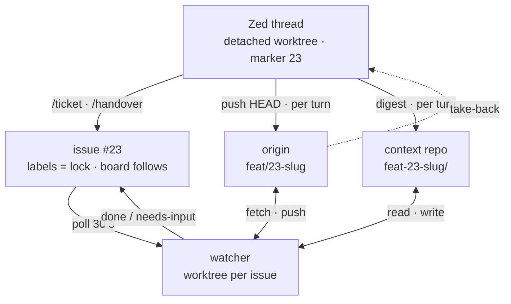

# The agent workflow

How work gets from an idea to a branch, across a desktop editor and a headless
agent on the VPS, with a Forgejo kanban board as the shared view.

## What this is for

One maintainer, several agents, more work in flight than one person can watch.
The harness exists to make that safe to leave alone: **an agent must be able to
work unattended, and you must be able to trust the result without re-reading
everything it did.**

Five things follow, and every mechanism below is one of them:

1. **Sessions are disposable; tickets are not.** A session dies, is killed, or
   wanders off. State therefore lives in Forgejo labels and a marker file, never
   in a conversation — [States](#states).
2. **How much a session may assume is a decision, not a default.** A person in
   the room costs one sentence to correct; an unattended wrong inference costs a
   branch nobody asked for. Hence two lanes, and refinement before building —
   [the lane axis](#the-lane-axis--how-much-it-may-assume).
3. **Reasoning is published, not reconstructed.** A diff shows what was done, not
   what was considered and rejected — so the next agent redoes the rejected
   thing. Digests go up every turn — [Handover](#handover).
4. **Nothing may gate on what the agent controls.** `agent:done` means CI agreed,
   not that the session said so —
   [notes/agent-verification.md](notes/agent-verification.md).
5. **Standing facts live outside the agent.** What constrains all future work
   goes in `docs/notes/`, what explains one diff goes in the commit body. Context
   is the scarce resource, not tokens.

Everything below is driven by **Forgejo labels**. The board column is a
*projection* of them, never the source — see [Why the board cannot be the state
store](#why-the-board-cannot-be-the-state-store).

- [The three workflows](#the-three-workflows) — ① Zed, ② claude.ai/code, ③ issue watcher
- [Walkthroughs](#walkthroughs) — one feature, three routes in, and what the board shows at each step
- [The driven lane in practice](#the-driven-lane-in-practice) — ① and ②
- [The autonomous lane in practice](#the-autonomous-lane-in-practice) — ③
- [Handover](#handover)
- [States](#states)
- [The sync model](#the-sync-model) — how the three stay in step
- [Setup](#setup)
- [When it goes wrong](#when-it-goes-wrong)

## The three workflows

Two independent questions, not one. Keeping them apart is the whole point of
this section, because every mistake in this document so far came from collapsing
them into a single "local vs remote".

**Who is driving?** — is a person reading each answer and correcting course, or
is it running unattended? This decides how much it may assume, and it is what
the `driven` / `autonomous` labels mean.

**Where does it run?** — the workstation or the VPS. This decides whether you
have to be at your desk, and which machine's checkout, build cache and login the
session uses. ② and ③ share all three: same image, same volumes, same clone.

|  | **local** (workstation) | **remote** (VPS) |
|---|---|---|
| **driven** (person steering) | ① **Zed** | ② **claude.ai/code** |
| **autonomous** (unattended) | *(nothing — see below)* | ③ **issue watcher** |

So `driven`/`autonomous` and `local`/`remote` are **not two names for the same
split**. ① and ② share a lane and differ in host; ② and ③ share a host and
differ in lane. Everything that follows hangs off which of those two things you
are asking about.

### ① Zed — driven, local

`claude-acp` in Zed on the workstation. You are in the room, so a wrong
direction costs one sentence.

*Use it for:* work you want to stay in the loop on, and anything whose result
you have to look at.

### ② claude.ai/code — driven, remote

Remote Control into the `cartopolis-agent` container, reachable from a browser or
the phone app. **Same lane as Zed, not a variant of the watcher** — a person is
steering it turn by turn, so it is a full design/spec session that happens not
to be at your desk. `/ticket`, the `driven` label, the `Stop` hook and the
handover all apply to it unchanged.

*Use it for:* the same work as ①, from a browser or the phone — thinking,
specs, review, changes you can state and verify in text. Often the place a
ticket is written before ③ builds it.

### ③ Issue watcher — autonomous, remote

Headless `claude -p` in the `cartopolis-issue-watcher` container, triggered by an
issue or a label rather than by you. Nobody sees the intermediate turns, which
is why it [refines before it builds](#refinement) and why refinement is required
to cite the code rather than assume.

*Use it for:* work that should happen while you are not at a keyboard.
*Not for:* anything visual, or anything you cannot state precisely.

### ④ Autopilot — nobody steering at all

`viberfox-autopilot` on the VPS: a third container that files the next ticket
and lands the finished ones, so work continues while the maintainer is away.
Two jobs, one config file, and **no language model** — `tools/autopilot.ts`
decides only which frontier item in [`direction.md`](direction.md) has no ticket
yet, and which finished branch every Actions job passed on. The thinking is
still ③'s sessions, which refine the ticket and implement it.

The two jobs run on different clocks: a full `tick` (file + ship) hourly, and
a `ship`-only pass every five minutes in between. Filing is quota-paced anyway,
but shipping is a handful of API calls, and on one clock a branch whose CI went
green minutes after a tick sat mergeable for the rest of the hour.

It is a separate container from the watcher for one reason, and it is the same
reason the watcher has no `config:` volume: ③ spawns sessions whose prompt is
issue text anyone can write, and the merge token can push to `main`. The
autopilot holds that token, runs no session, reads no free text, and has no
clone to be edited in.

**The knob is `/data/agent/state/autopilot.json`**, re-read on every pass, so a
change to `ship` takes effect within five minutes, the rest within the hour,
and none of it needs a restart:

```json
{ "enabled": false, "ticketsPerDay": 1, "ship": false }
```

- `enabled` — file new tickets at all.
- `ticketsPerDay` — how many, and it never runs two at once regardless.
- `ship` — merge finished tickets and deploy, or leave them on `agent:done`
  for a person, which is where this lane stopped before.

Shipping is `agent:done` **plus** a `ship` label, and it re-checks every Actions
job on the branch head before merging rather than trusting the label: the
watcher also awards `agent:done` when CI never answered, and landing a branch on
no verdict is recoverable where publishing on no verdict is not. After the merge
it runs [`tools/deploy-main`](../tools/deploy-main), which gates on `main` being
green and deploys the simulator before the web client — they share one wire
protocol and `decode_app_frame` refuses a mismatch outright.

What it may not touch is in [`direction.md`](direction.md), and the sharpest one
is the wire protocol: a bump locks out every installed Android app and every
downloaded desktop binary, and no deploy from this machine reaches either.

### The lane axis — how much it may assume

A spec written with you in the room is reviewed as it is written. The same
ticket handed to the watcher raw has to be *inferred* from whatever the issue
says, and a confidently wrong inference costs a 45-minute session plus a branch
someone has to read to discover it went sideways. That is why the driven lane is
the default for real work, and why the autonomous one refines before it builds.

Each lane has a label, and which one is load-bearing depends on how much you
want running unattended:

| Label | Says | Load-bearing when |
|---|---|---|
| `driven` | hands off, a person owns this | `AGENT_NEW_ISSUE_MODE=refine` — the watcher acts by default, so tickets opt **out** |
| `autonomous` | take this: refine it, then build it | `AGENT_NEW_ISSUE_MODE=off` — nothing runs unless a ticket opts **in** |

Neither is redundant in the other's mode. With the watcher acting by default,
`autonomous` is still the only way to hand it a ticket it has already passed —
its cursor only ever moves forward, so an issue that sat in Backlog for a week
will never be picked up on its own.

`autonomous` differs from the bare `agent` label in how much it asks for:
`autonomous` runs the **full pipeline** (refine, then implement), `agent` means
"I have decided this is actionable, skip the spec". `autonomous` on a ticket
whose branch already exists skips refinement too — rewriting the spec of
half-built work is not an improvement.

> **`driven` names the lane, not the machine.** It means "a person is driving
> this ticket; the watcher must not touch it" — true of a claude.ai/code session
> on the VPS just as much as a Zed session on the workstation. It replaced
> `local`, which was a misnomer for exactly that reason; `local` is still
> accepted as an alias so nothing in flight breaks.

### The host axis — where the work happens

`local` and `remote` say nothing about how a session behaves; ① and ② follow the
same rules throughout this document. What the host decides is practical:

- **① requires your desk.** ② and ③ do not — ② is reachable from a browser or
  the phone app, and ③ needs nobody at all.
- **② and ③ share a machine**, and deliberately: same image, same volumes, so
  the same clone, crate cache and login serve both. A branch a claude.ai/code
  session pushes is one the watcher can pick up without fetching anything new.
- **Capabilities differ per host** — a container may not be able to run
  everything the workstation can. That is an operational fact about a given
  machine, not part of this workflow; the run-modes and tooling notes in
  CLAUDE.md are where it belongs, and a session that cannot run something is
  expected to say so rather than fake the result.

The fourth cell of the matrix is empty simply because no autonomous runner is
installed on the workstation. Nothing prevents one.

## Walkthroughs

Three ways an idea becomes a branch, and what the board shows at each step. The
column is always a projection of the labels — see [States](#states) for the full
mapping.

**A and B are both "an idea from the couch".** The difference is not where you
are, it is whether you want to think it through now:

- **A** — you cannot be bothered right now. Two lines into Forgejo, put the phone
  down. The agent reads the code and either writes the spec or comes back with
  questions. Nothing is lost if the idea was half-baked; the worst case is a
  ticket that parks on `agent:needs-input` until you feel like answering.
- **B** — you want to know whether the idea is any good *before* you commit to
  it. A session reads the actual code and tells you what it would touch, and you
  steer with short messages while it does the reading and the typing. That is
  cheap on a phone. What it is not is fire-and-forget: it is a conversation, and
  it wants your attention until the spec is settled.

Reach for B when the idea might be wrong, or might be bigger than it looks.
Reach for A when it is obviously worth doing and you simply are not going to
write it up now.

**C is not a third way of filing a ticket, it is a different amount of
involvement.** An agent writes the code in all three; what changes is how long
you stay in the conversation:

| | Spec written by | Built by | You are present |
|---|---|---|---|
| **A** | the autonomous agent, alone | the autonomous agent | not at all |
| **B** | you *and* an interactive agent | the autonomous agent | until the spec is settled |
| **C** | you *and* an interactive agent | **the same interactive agent** | throughout |

So B and C start identically and diverge at the handoff. Stay in C when the
implementation needs judgement rather than execution, or when the result has to
be looked at — that is the only lane where `cargo shots` runs.

### The example

All three use the same idea, so the paths can be compared:

> **"Warn me when I'm driving over the speed limit."**

It is a good example because it sounds like an afternoon and is not. Driver mode
already shows current speed in a pill (`driver.rs:958`). What it has no access to
is the *limit*: `TravelMode::max_speed_ms` (`routing.rs:145`) is the A\* heuristic
bound per travel mode — documented to err *upward* on purpose — not a posted
limit, and the Shortbread tiles carry only `kind`, `oneway`, `surface` and
`bicycle`. There is no speed limit anywhere in the data.

So the honest answer is a question: where should the limit come from? That is
exactly the thing a one-line ticket cannot say and a confident agent would
invent.

### A. Straight into Forgejo — the agent decides

| # | What happens | Board |
|---|---|---|
| 1 | You open an issue titled *"Warn me when I'm speeding"*, body: *"Driver mode should tell me when I'm over the limit."* No labels. | *not on the board* |
| 2 | Within 30 s: `agent:refining`, plus a comment saying it has been picked up | **Backlog** |
| 3 | A read-only session reads `driver.rs`, `routing.rs` and the tile schema. No branch, no commits. | **Backlog** |

It finds the gap above, so it does **not** write a spec:

| # | What happens | Board |
|---|---|---|
| 4 | `agent:needs-input`. The description is rewritten with what it found — the speed pill at `driver.rs:958`, `max_speed_ms` being a heuristic bound, the tile layers that exist — and ends in **Open questions**: *derive a default per road `kind`? add `maxspeed` to the tile pipeline? query Overpass live?* Each with its cost. | **Backlog** |

**Nothing is built.** That is the point: three plausible answers, and picking
wrong costs a 45-minute session plus a branch you have to read to discover it
went the wrong way.

| # | What happens | Board |
|---|---|---|
| 5 | You reply: *"@agent refine — defaults per road kind for now, table in routing.rs, no new data source"* | **Backlog** |
| 6 | It rewrites the spec against that decision: `agent:refined` | **To Do** |
| 7 | Queued until a slot frees, then `agent:running` | **In Progress** |
| 8 | Branch `feat/23-warn-driving-speed-limit` pushed, `agent:done`, waiting for your review | **Done** |

### B. claude.ai/code — spec with an agent, build with the autonomous one

Same idea, but you want to know whether it is any good before committing to it —
and once you do, you want to stop thinking about it.

Two agents, and that is the whole shape of this path: an **interactive** one
writes the spec with you, then the **autonomous** one builds it unattended.

| # | What happens | Board |
|---|---|---|
| 1 | You open a session and say *"can we warn when speeding in driver mode?"* | — |
| 2 | It reads the same code and tells you, **in the conversation**, that there is no `maxspeed` in the tiles — the same finding as A3, but in a minute and with you there to react | — |
| 3 | You settle it together: defaults per road `kind`, amber pill over the limit, no new data source. Two messages, not a design round. | — |
| 4 | `/ticket --label agent` files it with the agreed spec and a `` Branch: `` line | **To Do** *(queued)* |
| 5 | The watcher picks it up: `agent:running` | **In Progress** |
| 6 | Branch pushed, `agent:done` | **Done** |

**No refinement pass** — `agent` means "I have decided this is actionable", and
you just did, live, with the code in front of you. The difference from A is not
the outcome but *when the question got asked*: step 2 instead of a round trip
through the issue tracker.

After step 4 you are done. Steps 5 and 6 happen whether you are watching or not,
which is what you traded the conversation for.

### C. Zed — spec and build with the same local agent

> Changing — see [The sync model](#the-sync-model).

Same idea, at your desk. The local agent builds it too — you are not typing the
code, you are steering it turn by turn, the same way you steered the spec in B.

The difference from B is not who writes the code but **how far the conversation
goes**: B hands off after the spec, C keeps the same session through the
implementation. Choose C when the implementation itself needs judgement rather
than just execution, or when you need to *look* at the result — this is the only
place `cargo shots` runs, and an amber pill is a thing you check with your
eyes.

| # | What happens | Board |
|---|---|---|
| 1 | `/ticket` files it with the spec, labelled `driven`, and moves you from `main` onto `feat/23-warn-driving-speed-limit` — created, checked out, no naming decision to make | **Backlog** *(seeded once)* |
| 2 | You and the session work through it, correcting course as it goes. Every turn the `Stop` hook publishes the chat digest and pushes the branch. | **Backlog** — the watcher never moves a `driven` card |

**C1 — it gets finished.** Merge with `finish-branch`, close the issue.

| # | What happens | Board |
|---|---|---|
| 3 | Issue closed | **Done** |

**C2 — you get pulled away.** Remove the `driven` label, and the autonomous
agent continues from where the local one stopped.

| # | What happens | Board |
|---|---|---|
| 3 | The watcher reads `` Branch: `feat/23-warn-driving-speed-limit` `` , finds it on `origin`, and **takes it over** instead of cutting a fresh branch from main | **To Do** |
| 4 | It fetches `refs/agent-context/feat/23-warn-driving-speed-limit` and reads every session digest, oldest first | **In Progress** |
| 5 | Continues from your commits, pushes, `agent:done` | **Done** |

Step 4 is where the digest earns its keep. The diff shows a `kind`→speed table
appearing in `routing.rs`. It does not show that you *considered* adding
`maxspeed` to the tile pipeline and rejected it as too much for this ticket —
so without the digest the next agent is free to "improve" the work by doing
exactly the thing you already decided against.

Only committed work survives step 3; see [Handover](#handover).

## The driven lane in practice

Identical in ① and ②.

### File the ticket

Use the [`/ticket`](../.claude/skills/ticket/SKILL.md) skill. It writes a spec —
problem, approach, acceptance criteria, verification, out of scope — shows it to
you before filing, then creates the issue with the `driven` label.

```bash
.claude/skills/ticket/file-issue --title "..." < /tmp/spec.md
```

The card appears in **Backlog** within 30 s. Neither driven context places it
itself; the watcher does, so the bot's board password stays in one place instead
of being copied to a laptop and a container.

Credentials are `~/.config/cartopolis/forgejo.env` (`0600`, scope `write:issue`) in
whichever context you are in — the workstation and the container each hold their
own token. Both author issues as **you**, not as the bot: a person is driving,
and it keeps the `@agent` comment path working, since the watcher ignores
comments authored by `cartopolis-agent` as a loop-breaker.

**You never name a branch, and never notice one being named.** Filing a ticket
puts you on the right branch:

- **On `main`** — which is where an editor sitting on the repo normally is — it
  creates `<type>/<number>-<slug>` from the title and checks it out, carrying any
  uncommitted poking-around with it. `"Map is slow when zooming out"` gives
  `perf/25-map-slow-zooming-out`.
- **On a feature branch already** — it takes the number:
  `fix/road-joins` → `fix/12-road-joins`. A branch already numbered, or already
  pushed to `origin`, is left alone; renaming a pushed branch would orphan it and
  its context ref.

The number only exists once the issue does, which is why this happens on filing
rather than when you cut a branch. Pass `--branch <type>/<slug>` to override the
derived name; the number is still injected for you.

The watcher names branches the same way when a ticket has no `` Branch: `` line
of its own. A refinement session proposes the name — it has read the code, so it
knows whether the change is a `fix` or a `feat` and which area it touches — and
the watcher validates the shape and injects the number:
`fix/23-routing-speeding-pill`. With no refinement to ask, it derives one from
the title (`"Map is slow when zooming out"` → `perf/25-map-slow-zooming-out`).
Either way the branch matches the repo's commit convention, so a branch name and
the commits on it agree about what the change is.

That name is then written into the issue body as a `` Branch: `` line, which is
not decoration — see [Handover](#handover).

### Work

Ordinary sessions on an ordinary branch. Two things happen automatically from
the `Stop` hook in `~/.claude/hooks/agent-context-push`:

1. a mechanical digest of the session is published to
   `refs/agent-context/<branch>` in the private context repo
2. the branch is pushed to `origin`, if it has commits

**This runs at the end of every turn, not when the session ends.** Measured on
this branch: one session, eight publications. Each one rewrites the same
`<session-id>.md` with the transcript so far, so the digest is never more than a
turn stale and a session that is killed, crashes or is simply abandoned still
leaves its reasoning behind. Several sessions on one branch means several files
on the ref, which is why they are read oldest-first.

The hook is scoped by **remote URL**, not by where it is installed: it lives in
the global settings and exits silently in any repo whose `origin` is not
cartopolis. Without that guard it would publish chat digests into every other
project on the workstation.

**The same script runs in both driven contexts** — `~/.claude/hooks/` on the
workstation and `/home/agent/.claude/hooks/` on the `agent_claude` volume. They
must stay byte-identical; `md5sum` both after touching either. They drifted once
already, and the symptom was silent: claude.ai/code sessions published their
digest but never pushed their branch, so a handover got the reasoning and none of
the code.

Each claude.ai/code session gets its own worktree (`--spawn worktree`) on its own
branch, so the digest is per-branch there exactly as on the workstation. The
worktree *directories* are named `bridge-cse_*`, but the branches are ordinary
`feat/…` / `fix/…` names — which is what the hook keys on.

> **Never work on `main`.** The `Stop` hook skips it, so nothing is published and
> nothing is pushed; commits there are rejected by branch protection only once
> the work is done. All three fail silently, which is why `/ticket` moves you off
> `main` rather than warning you about it.

> **Commit before you walk away.** The *reasoning* is safe either way — it is
> republished every turn. The *code* is not: only committed work is pushed, so
> uncommitted changes do not survive a handover. The digest header records the
> file count (`uncommitted at stop: 7 file(s)`) so the next agent knows something
> existed, but nothing can recover it.

## The autonomous lane in practice

A new issue with no `driven` label is **refined** before anything is built.

### Refinement

Read-only: a detached worktree, no branch, no commits. The session reads the
code and rewrites the issue description as a spec. Two rules make it useful
rather than confident:

- **Every claim about current behaviour needs a `file.rs:line`.** A spec that
  cannot cite is a spec that guessed.
- **A criterion it would have to guess at is a question, not a criterion.**

It ends with one of two statuses:

- `agent:refined` → card to **To Do**, and the watcher picks it up for
  implementation on the next poll. The auto-chain.
- `agent:needs-input` → card stays in **Backlog** with the open questions in the
  description. **Nothing is built.**

A refinement that returns no status line at all is treated as `needs-input`. An
unclear signal must not start a build.

### Implementation

A worktree on the issue's branch, cut from `origin/main` unless it is a
[takeover](#handover). Verify with `cargo check -p <crate>` and
`cargo test -p cartopolis_geo && cargo test -p cartopolis`, commit in Conventional
Commits style, push the branch. `main` is protected: direct pushes are whitelisted
to `jeroen`, so the bot cannot push to it. It *can* open and merge a PR through
the API — the protection sets no merge whitelist, no required approvals and no
status checks — but that is a thing to do when asked, not a lane the bot drives
itself into.

> **Not `--bin cartopolis`.** That was the command here until 2026-08-06, and since
> the lib+shim split ([client-build-cost.md](notes/client-build-cost.md)) it runs
> **0 of cartopolis's 207 tests** — `main.rs` is a nine-line shim with none in it —
> and exits 0. The autonomous lane's only test gate was passing unconditionally.
> `cartopolis_geo` goes first because it fails in ~2 s on a geodata regression,
> before the client's codegen.

`agent:done` means **a branch is waiting for review**, not shipped.

### Landing it: the driven lane verifies its own branch and pushes (2026-08-30)

In the driven lane you are in the room, so the review has already happened in
conversation. Saying **"merge to main"** is the instruction to land it, and the
session does it rather than handing back a branch for you to PR by hand:

```bash
.claude/skills/finish-branch/merge-to-main
```

It rebases onto `origin/main`, runs CI's gate **locally**, pushes the branch,
fast-forwards `main` to it and closes the ticket. There is no pull request.

**Why the pull request went.** `ci.yml` has no push trigger on branches, so
opening a PR was the only way to start a run at all. That made the cost of
landing anything two full runs of a 15-25 minute workflow, on a runner with
capacity 3 shared with nominatim and overpass, for one tree — once on the
pull-request ref and once on the merge commit. And the first of the two was
increasingly not read: of the eight merges before this change, five went from
"PR opened" to "PR merged" in under six seconds. A pull request that exists for
six seconds is not a review, it is a way to start a build and walk away from it.

So the verdict moved to where the code already is:

```bash
.claude/skills/finish-branch/verify-branch
```

which runs the same commands out of the same workflow file — `cargo fmt
--check`, `cargo test --locked --workspace --exclude cartopolis_android`, and,
when the diff can change a frame, the three headless smokes and the wasm and
android target checks. It scopes itself with `ci.yml`'s own deny-list (a commit
touching only `docs/`, `crates/simulator/`, `.forgejo/`, `.claude/` and `*.md`
cannot change a frame) and it **names on stdout everything it skipped**, because a gate that
quietly narrows itself reads as a pass over ground nobody covered.

Four properties are deliberate:

- **The gate is a script, not a sentence.** `docs/notes/agent-verification.md`
  corollary 1 — a check written as prompt text is advice — is the reason this is
  270 lines of bash in the repository rather than a step in a prompt. A session
  cannot narrow `--workspace` to the package it was working in, because it does
  not choose the argument.
- **A pass is a receipt, keyed on the head sha.** `merge-to-main` refuses a head
  that has none. Committing or rebasing moves the sha, so a pass earned on one
  tree cannot be spent on another — which matters most right after the rebase
  the script itself performs.
- **`main` is a fast-forward, never a force.** A rejection means another session
  landed in between; the answer is to re-run and let the rebase pick it up, not
  to overwrite them. No merge commits, so `git log` on `main` reads as the
  sequence of changes it actually is.
- **One token, and it is the weaker one.** `main` is no longer protected, so the
  code goes up as an ordinary SSH push. The only API call left closes the
  ticket, which `forgejo.env`'s `write:issue` token has always been able to do —
  the repository-write token in `forgejo-merge.env` is no longer on this path.

**The autonomous lane does not get this.** It stops at `agent:done` as before,
and the autopilot (`tools/autopilot.ts`) still opens a pull request and reads
Forgejo's Actions verdict on the branch head before merging. That is not
inconsistency: it holds no checkout and no build environment — `deploy-main`
deliberately works from the API alone — so it *cannot* run the gate above, and
it has no person in the room who said the word. The difference is the lane, not
the machine.

### The verdict is still CI's, and it now arrives afterwards

CI has not been switched off. The push to `main` runs it, and on `main` it runs
**more** than a pull request ever did: the three render smokes and both
cross-target lanes are `main`-only. What changed is when the answer lands.

That is a real weakening and is worth stating plainly rather than dressing up.
The old rule was that only CI's verdict on the pushed head may end a ticket,
because an evaluator the agent can influence is not an evaluator. The local gate
runs the same commands, but it runs them on the machine the agent is on, and it
cannot reproduce a clean checkout or a cold cache. What is kept of the rule: the
invocations are fixed in a checked-in script, the pass is recorded against a sha,
and the independent run still happens — a red `main` is fixed forward, and
`tools/deploy-main` still refuses to publish a commit whose CI never went green,
which is the gate that actually protects strangers.

The autonomous lane's own gate is unchanged: a session that pushes commits gets
`agent:ci`, and the watcher resolves it from Forgejo's commit status for the
pushed head — green → `agent:done`, any failing check → `agent:failed` with the
job named in a comment. Four details there are load-bearing:

- **The wait does not hold a slot.** `pollCi` runs in the poll loop, not inline in
  `handleIssue`; blocking there would occupy one of `AGENT_MAX_CONCURRENT` (2) for
  the length of a cold Bevy build with nothing running in it.
- **It gates on the head as `origin` holds it**, not as the worktree does. They
  differ exactly when the push failed — and a local commit has no CI run behind
  it, so gating on it would wait forever.
- **A timeout lands on `done`, never on `failed`** (`AGENT_CI_TIMEOUT_MIN`, 45),
  with a comment saying there was no verdict. "CI did not answer" is not "the
  work is wrong". Same for a commit no workflow claimed.
- **It is failure-tolerant**, like every board call: a status API that breaks logs
  a warning and the ticket still lands. `AGENT_CI_GATE=off` disables it, and the
  startup banner says so in as many words when it is off.

Note that `Deploy web` runs only on `main`, so an agent branch is judged by the
`CI` workflow alone. If that ever gains a branch trigger, every agent ticket
inherits its result — which matters, because the web deploy has been failing on
`main` since at least 2026-08-06.

### Talking to it

- `@agent <instruction>` — resume that issue's session with a new instruction.
  On a `driven` issue this doubles as the handover.
- `@agent refine <what is wrong>` — throw the spec away and write it again.
- `agent:skip` — hands off, permanently.

Only users in `AGENT_ALLOWED_USERS` (currently `jeroen`) can start work by
comment. Labelling is already restricted to users with write access, so the
label triggers need no allowlist.

## Handover

The driven lane stalls; the watcher picks it up. **Remove the `driven` label**
(or comment `@agent`).

Three things have to line up, and each one used to fail silently:

**The branch.** The watcher reads `` Branch: `feat/x` `` from the issue body. The
two lanes name branches differently — local uses `feat/…`, the watcher used to
derive its own — so without that line a takeover would cut a *fresh* branch from
main and ignore every local commit. `main` in that line is ignored.

**The work.** A branch already on `origin` means a takeover: the worktree is
checked out where the branch is, and `freshenWorktree` is skipped. It resets to
`origin/main` when a tree is clean and has no commits of its own, which is right
for a retry and catastrophic here — a fresh worktree also has no commits of its
own.

**The reasoning.** `refs/agent-context/<branch>` carries a digest of the
session(s) that built the branch: what was decided, what was rejected, what was
left unfinished. The watcher fetches it into the worktree and the takeover
prompt points at it; the [`branch-context`](../.claude/skills/branch-context/SKILL.md)
skill documents what to pull out. **Read every session file, oldest first** — the
earliest usually holds the design decision and the later ones only execute it.

If no digest exists, the agent is told to say so rather than invent intent.

> **The digests live in a separate, private repo** —
> `jeroen/cartopolis-agent-context`, not in cartopolis, which is public. Measured:
> an anonymous clone plus an explicit `+refs/agent-context/*` refspec retrieved
> every digest from a public repo, no account needed. A namespace outside
> `refs/heads/*` keeps transcripts out of a routine clone; it was never an
> access control.
>
> The digest keeps user and assistant prose verbatim and one line per tool call;
> it drops tool *results*, thinking, and slash-command plumbing. Because a
> transcript is not reviewed before it is published, the filter also redacts
> values after `password=`, `token:`, `Authorization:` and vendor-prefixed keys.
> **The digest is kept after the branch lands.** It used to be destroyed at
> merge time, which only made sense while digests sat in the public repo; a
> private one removes the reason, and the reasoning is worth more than the
> branch. Deleting one is now a manual escape hatch — see
> [notes/agent-context-refs.md](notes/agent-context-refs.md) and the
> [`finish-branch`](../.claude/skills/finish-branch/SKILL.md) skill.

## States

The labels are the state machine. The column follows.

| Label | Column | Meaning |
|---|---|---|
| `driven` (or `local`) | Backlog¹ | A person owns it. The watcher never touches it. |
| `agent:skip` | Backlog¹ | Nobody acts on it. |
| *(none)* | Backlog | New. Refinement starts on the next poll, unless `AGENT_NEW_ISSUE_MODE=off`. |
| `autonomous` | Backlog | Opt in: refine, then implement. Works on any issue, however old. |
| `agent:refining` | Backlog | Reading the code, writing a spec. Read-only. |
| `agent:needs-input` | Backlog | Refined, but blocking questions. **Parked.** |
| `agent:refined` | To Do | Spec agreed. Queued for implementation. |
| `agent` | To Do | Explicit "implement this now" — skips refinement. Also the takeover gesture. |
| *(any, issue closed)* | Done | Forgejo does not do this itself; the watcher moves cards it placed. |
| `agent:running` | In Progress | A session is running **right now**. |
| `agent:ci` | In Progress | Session over, branch pushed, waiting for CI's verdict. |
| `agent:done` | Done | Branch pushed **and CI passed**, waiting for review. |
| `agent:failed` | To Do | Needs a human. |

¹ Seeded once, then never moved again. A card the agent did not place is one you
dragged, and it stays where you put it — the watcher only ever moves cards it put
there itself.

**To Do means queued**, not merely eligible: a ticket enters it the moment it is
enqueued, and leaves for In Progress when a concurrency slot frees
(`AGENT_MAX_CONCURRENT`, currently 2). Before this was wired up a ticket handed
straight to the agent sat off the board entirely and then appeared in In
Progress, which made To Do a column that never meant anything.

**Closing an issue moves its card to Done.** Forgejo has no such behaviour of its
own — checked in its source — so without this a ticket you finished by hand kept
its old column and the board slowly filled with shipped work.

`In Progress` means a session is live, which is what makes a crashed one
visible: a session killed mid-run leaves the issue stuck on `agent:running` **on
purpose**. Silently retrying an unknown half-finished state is worse than a
visible stall.

### Why the board cannot be the state store

Forgejo 16.0.1 has **no REST API for projects**. Nothing matching `project` or
`column` appears in `swagger.v1.json`, and neither `Issue` nor `EditIssueOption`
carries a project field. The board is reachable only through two *web* routes,
and those use session authentication — an API token is rejected outright.

So `board.ts` logs in with the bot's password and keeps the cookie. That works
because Forgejo 16 removed CSRF tokens entirely in favour of Go's header-based
`CrossOriginProtection`, which passes any request with no `Origin` and no
`Sec-Fetch-Site` — every non-browser client. Three things about it are
load-bearing:

- **Login must go over `https://`.** The session cookie is `Secure`, so a POST
  to the internal `http://172.17.0.1:3000` returns a perfectly good `303` and
  sets a cookie the client must discard. You get a successful login followed by
  404s on every authenticated route.
- **Adding a card is a batch route** — `POST /{owner}/{repo}/issues/projects`
  with `issue_ids`, not a per-issue `/issues/{index}/projects`. The latter 404s
  in a way that reads exactly like a permissions problem.
- **Both routes take the issue's internal `id`, never its `#index`.** They agree
  on a young repo and diverge silently later.

Because that path is a password session against un-versioned web routes, a
Forgejo upgrade can break it. Every board call is therefore failure-tolerant:
it logs a warning and the work proceeds. Labels remain correct; only the card
position goes stale.

## The sync model

How issues, local Zed sessions and the remote agent stay in step. Built and
exercised; the walkthroughs above still describe the older branch-switching
flow and are rewritten next.

### The picture



### One key: the issue number

A unit of work exists in four places. Every one derives from the issue number,
so nothing is kept in sync by hand:

| Holder | Form | Derived how |
|---|---|---|
| Forgejo issue | `#23` | the source |
| Remote branch | `feat/23-warn-driving-speed-limit`, **origin only** | number + slug |
| Context dir | `feat-23-warn-driving-speed-limit/` | remote branch, `/`→`-` |
| Session binding | `.git/cartopolis-ticket` containing `23` | written by `/ticket` |

The Stop hook keys on the **marker file**, not the branch name. That closes the
silent hole hit three times (`main`, `worktree-*`, detached HEAD): a ticketed
session publishes no matter where its checkout points. A session with no marker
is exploratory and publishes nothing — by choice, not by accident.

### Branches live only on origin

Git needs a named ref to *receive* code; that is all a branch is here. Locally
there are none: every worktree stays **detached** (Zed's default), and code
travels by `git push origin HEAD:feat/23-…`, the name derived from the marker.
You never create, name, switch or push a branch — the hook does, invisibly.

- Zero local branches → the one-branch-per-worktree rule is moot; nothing to
  name, nothing to collide.
- Two sessions on one ticket still collide **at push time** (non-fast-forward,
  never forced). The label lock is the real guard: claim before working.
- Landing and `finish-branch` see an ordinary branch on origin. Nothing
  downstream changes.

### Context repo: plain files on `main`

`cartopolis-agent-context` loses the ref namespace (invisible in Forgejo, needs a
fetch incantation, existed only to be deletable — digests are kept now):

```
feat-23-warn-driving-speed-limit/
    <session-id>.md          one file per session — local and remote alike
```

- Browsable, `git grep`-able, plain clone. `git log` = all agent activity.
- Parallel sessions write different files → pushes never conflict, only rebase.
- Stop hook: temp shallow clone → write → commit → push (rebase-retry). Per turn.
- Read oldest-first, as today.
- Prune machinery and `finish-branch` destruction step: deleted.

### Ownership is a lock

The labels already are one; stated as the rule it is:

| Label | Locked by |
|---|---|
| `driven` | you |
| `agent:running` | the watcher, right now — touch nothing |
| `agent` / `autonomous` / `agent:refined` | queued for the watcher |
| `agent:needs-input` / *(none)* | free — claim before working |

### The whole local interface: two commands

| | |
|---|---|
| `/ticket` | **Start of every session, by hand.** Files the issue from the conversation, `driven` label, writes the marker. No branch creation, no checkout switching — where you sit is Zed's business. |
| `/ticket 23` | Same binding, existing issue: claims it (`driven`), writes the marker, detaches the worktree onto `origin/feat/23-…` if it exists. Refuses while `agent:running`. |
| `/handover` | Sweeps leftovers into a `wip:` commit, pushes `HEAD` to the ticket's remote branch, verifies this session's digest is in the context repo, `driven`→`agent`, comments on the issue. Refuses without a marker — ticket first. |

Take-back (remote→local) is not a command: wait until not `agent:running`, then
`/ticket 23` in a fresh worktree — it fetches and detaches onto the ticket's
remote branch.

### Parallel sessions in Zed

- One thread = one worktree = one ticket. Zed 1.13 creates and removes
  worktrees natively; archiving a thread cleans its worktree up.
- No local branches means nothing to name and nothing to collide; the marker
  is what tells worktrees apart, and push-time rejection catches two sessions
  on one ticket.
- A `SessionStart` hook reads the marker and injects `#23` + spec + context
  path into every new or resumed session in that worktree, so binding
  survives thread restarts. (Verified: SessionStart supports context
  injection; Stop fires once per turn.)

### Remote side: symmetry

The watcher writes the same marker into its worktrees; the same Stop hook
publishes the same way; `fetchAgentContext` becomes "read the ticket's
directory". No second mechanism.

### Sync summary

| What | Channel | When |
|---|---|---|
| Code | ticket branch on `origin`, pushed as `HEAD:` | per turn if commits exist; `/handover` sweeps WIP |
| Reasoning | ticket dir in context repo | per turn, both sides |
| Ownership | issue labels | `/ticket`, `/handover`, watcher |
| Board | columns | watcher, from labels — unchanged |

### Verified

- Marker is per-worktree and dies with it; the Stop hook keys on it, publishes a
  plain file, and pushes `HEAD:<branch>`.
- Three concurrent sessions pushed digests at once — all four files landed,
  rebase-retry held.
- `/ticket` create and bind; the claim guard refused a second worktree by path.
- `/handover` swept, pushed, confirmed the digest, flipped the label — and the
  watcher **took the branch over rather than restarting it**, which had never
  been exercised before.

### Still unproven

- **Parallel builds work: sccache, measured at 85.6 % hits.** Each worktree
  builds into its own default `target/` — no cargo lock — and sccache refills it
  from cache (76 s → 49 s on the simulator graph). The one rule: **never export
  `CARGO_TARGET_DIR`**; sccache hashes that env var and it silently zeroes the
  hit rate. See [notes/sccache-parallel-builds.md](notes/sccache-parallel-builds.md)
  for the root cause and the earlier wrong conclusion it replaces.
- **The Stop hook has never been observed firing from a Zed ACP session.** Every
  test so far drove it by hand or through remote-control.

## Setup

**① Zed — the workstation**

| What | Where |
|---|---|
| `Stop` hook + jq filter | `~/.claude/hooks/agent-context-push`, `agent-context.jq` |
| Hook registration | `~/.claude/settings.json` → `hooks.Stop` |
| Forgejo token (`write:issue`) | `~/.config/cartopolis/forgejo.env`, `0600` |
| Digest destination | `jeroen/cartopolis-agent-context` (private), over SSH. Override with `CARTO_AGENT_CONTEXT_REMOTE` |

**② claude.ai/code — the `cartopolis-agent` container**

| What | Where |
|---|---|
| Same `Stop` hook + jq filter | `/home/agent/.claude/hooks/` on the `agent_claude` volume |
| Hook registration | `/home/agent/.claude/settings.json` → `hooks.Stop` |
| Forgejo token (`write:issue`) | `/home/agent/.config/cartopolis/forgejo.env`, `0600` |

**③ Issue watcher — the `cartopolis-issue-watcher` container** (`/data/agent/`, docs in `README.md` there)

| What | Where |
|---|---|
| Watcher + board driver | `issue-watcher/watcher.ts`, `issue-watcher/board.ts` |
| Token, bot password | `watcher.env`, `0600` |
| Modes, labels, column ids | `docker-compose.yml` → `environment:` |
| CI gate | `AGENT_CI_GATE` (default on), `AGENT_CI_TIMEOUT_MIN` (45) |

**④ Autopilot — the `viberfox-autopilot` container** (`/data/agent/`)

| What | Where |
|---|---|
| The two scripts | `autopilot/autopilot.ts`, `autopilot/deploy-main` — copies of `tools/` in this repo |
| Tokens (`write:issue` **and** `write:repository`) | `autopilot.env`, `0600` — deliberately not `watcher.env` |
| The knob | `state/autopilot.json`, re-read every tick |
| Tick interval | the `command:` loop in `docker-compose.yml` (hourly) |

Updating either script is a copy from this repository into `/data/agent/autopilot/`;
the mount is read-only and the container picks the new file up on its next tick.

The `Stop` hook exists in two places on purpose — ① and ② are separate
environments — but it is the same script. `md5sum` both after editing either;
see the warning under [Work](#work) for what drift looks like. ③ needs no hook:
it publishes nothing, because the watcher already reports on the issue itself.

`AGENT_NEW_ISSUE_MODE` chooses what a new issue gets: `refine` (default),
`implement`, or `off`.

> `env_file` is read when a container is **created**, not started. Adding a
> variable needs `docker compose up -d --force-recreate`; a `restart` keeps the
> old environment, which reads as "the new code does nothing".

## When it goes wrong

**A card is in the wrong column.** Cosmetic. Check the labels — they are the
truth. `docker logs cartopolis-issue-watcher` will have a `[board]` line saying
what failed.

**Cards stopped moving entirely.** The bot's session or password. The watcher
logs `board: DISABLED` at startup if `FORGEJO_BOT_PASSWORD` is unset — which is
what a `restart` instead of a `--force-recreate` looks like.

**An issue is stuck on `agent:running`.** A session died. This is deliberate,
not a bug. Read `/data/agent/state/logs/issue-<n>.log`, then remove the label and
apply `agent` to requeue.

**A takeover ignored the local work.** The issue body had no `` Branch: `` line,
or the branch was never pushed. Check `git ls-remote origin <branch>`.

**A refinement built the wrong thing anyway.** `@agent refine` with the
correction, or take it local. If this happens more than occasionally, the issue
arrived too raw — file it from `/ticket` instead.

**The digest is missing for a branch.** The session was killed before `Stop`
fired, or it predates the hook. Nothing recovers it; work from the commits.
